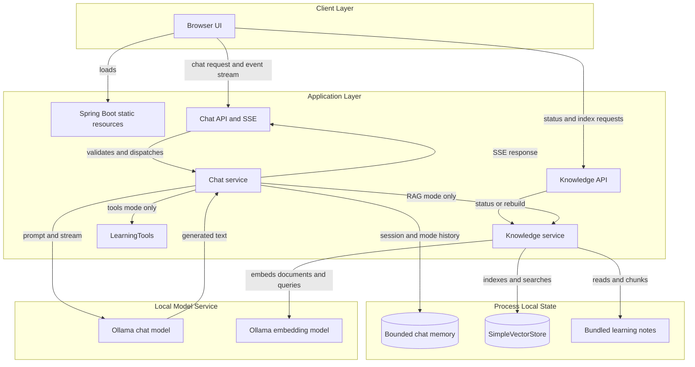
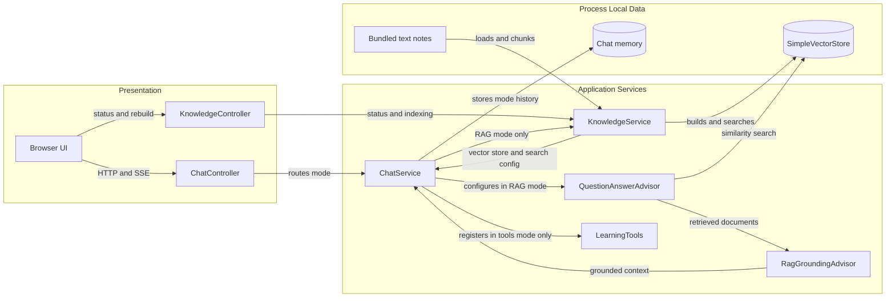

# Architecture Diagram

Spring AI Fundamentals is a single Spring Boot WebFlux application with a browser UI, three separate chat modes, and local Ollama model integrations. Its learning-note index and chat histories are process-local and are rebuilt or cleared when the application restarts.

## Application Architecture

<!-- mermaid-checked: no \n, no em-dash/en-dash, no {} in labels, subgraphs are id["label"], arrows are -->|"label"|, all subgraphs closed by end, ids unique -->

### Technology Stack Summary

| Layer | Technology | Version | Purpose |
| --- | --- | --- | --- |
| Browser | HTML, CSS, JavaScript | — | Learning UI and SSE client |
| Web application | Spring Boot and Spring WebFlux | 4.0.0 | Static resources and reactive HTTP APIs |
| AI integration | Spring AI | 2.0.1 | ChatClient, Ollama models, advisors, embeddings, vector store |
| Runtime | Java | 21+ | Application services and tool execution |
| Chat model | Ollama, `llama3:latest` by default | Configurable | Tutor and RAG answer generation; tools mode needs a tool-capable model |
| Embedding model | Ollama, `nomic-embed-text` by default | Configurable | Document indexing and query vectors |
| Knowledge store | `SimpleVectorStore` | In-memory | Note text, metadata, and embeddings |
| Conversation memory | Spring AI chat memory | In-memory | Bounded history per WebSession and chat mode |

### Data Storage & External Services

The application has no relational database, persistent vector database, message broker, or web-search integration. Bundled text notes are read from application resources; their chunks and vectors are held in `SimpleVectorStore` in process memory. Spring AI chat memory is also in memory and keyed by the server WebSession and mode. Ollama is the external local service for both chat generation and embeddings, using a shared configurable base URL.

### Key Architectural Decisions

- RAG, general tutor, and tools are separate modes. The default RAG path does not register or invoke `LearningTools`.
- First-use RAG requests prepare the index; app startup and knowledge-status checks do not call Ollama.
- A replacement vector index is built before publication. The in-memory implementation is for learning and does not persist across restarts.

## Component Relationships

<!-- mermaid-checked: no \n, no em-dash/en-dash, no {} in labels, subgraphs are id["label"], arrows are -->|"label"|, all subgraphs closed by end, ids unique -->

### Component Inventory

| Component | Layer | Type | Responsibility |
| --- | --- | --- | --- |
| Browser UI | Presentation | Static web client | Selects mode and topic, submits requests, reads SSE, and reports index status |
| `ChatController` | Presentation | WebFlux controller | Validates chat input, uses the WebSession, streams events, and clears history |
| `KnowledgeController` | Presentation | WebFlux controller | Reports knowledge status and exposes an explicit index rebuild |
| `ChatService` | Application | Spring service | Dispatches chat modes and configures model prompts and chat-memory advisor |
| `KnowledgeService` | Application | Spring service | Loads and chunks notes, builds or replaces the vector store, and supplies retrieval settings |
| `QuestionAnswerAdvisor` | Application | Spring AI advisor | Searches the vector store and adds retrieved passages to the RAG request |
| `RagGroundingAdvisor` | Application | Spring AI advisor | Prevents model generation when retrieval produces no usable documents |
| `LearningTools` | Application | Spring AI tools | Exposes read-only time and lesson-outline methods in tools mode only |
| `SimpleVectorStore` | Data | In-memory vector store | Holds indexed note chunks, metadata, and embeddings |
| Chat memory | Data | In-memory conversation store | Maintains bounded histories keyed by WebSession and mode |
