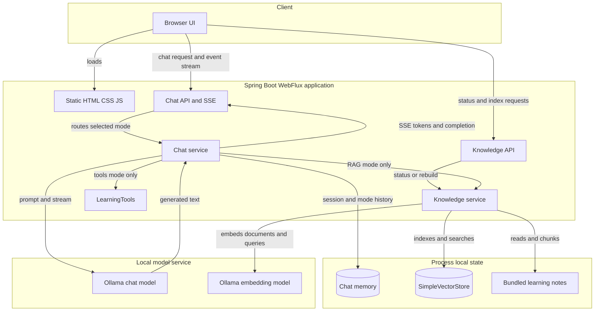
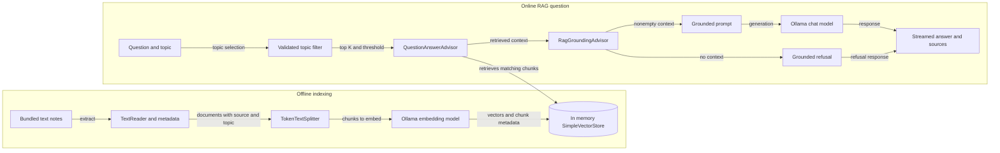

# Spring AI Fundamentals

An interactive learning app for modern AI concepts and the Spring AI programming model. Read the lessons, inspect Java examples, and experiment with a local tutor, document retrieval, and an optional Java-tools mode.

## What’s implemented

- **AI fundamentals:** the AI → machine learning → deep learning → generative AI relationship, how LLMs generate text, tokens, context windows, hallucinations, and training cutoffs.
- **Spring AI lessons:** `ChatModel` versus `ChatClient`, provider configuration, prompts and message roles, templates, model options, response metadata, streaming, multimodal input, structured output, and advisors.
- **Testing AI applications:** deterministic tests with mocked models, evaluator contract tests, and an opt-in suite that evaluates real RAG answers for relevance and factual support. The lessons also explain separate infrastructure checks with Testcontainers.
- **Observability:** Actuator and Prometheus expose HTTP and AI operation metrics; the optional tracing profile exports Micrometer spans through OpenTelemetry. The app shares its observation registry with manually constructed vector stores and Ollama HTTP clients, alongside auto-configured tool execution. Observation content logging remains opt-in.
- **RAG lessons:** embeddings, vector dimensions, similarity search, top K, similarity thresholds, metadata filters, and the extract → transform → load indexing pipeline. Advanced examples introduce query rewriting, routing, hybrid search, reranking, and context compression.
- **Spring AI RAG APIs:** `EmbeddingModel`, `Document`, `VectorStore`, `SearchRequest`, the ETL interfaces, `QuestionAnswerAdvisor`, custom context templates, and the modular `RetrievalAugmentationAdvisor`.
- **Tool-calling lessons:** tool descriptions and generated schemas, the model/application execution loop, argument validation, and application-controlled context through `ToolContext`.
- **RAG by default:** the chat starts in Learning tutor (RAG) mode, and API requests that omit `mode` also default to RAG. This mode retrieves relevant passages from bundled notes and does not invoke `LearningTools`. General tutor mode is an explicit alternative without retrieval; only the separately selected tools mode exposes the read-only Java functions in `LearningTools`.
- **Automatic first-use indexing:** the first RAG question prepares the bundled learning notes, splits them into chunks, creates embeddings with Ollama, and loads an in-memory `SimpleVectorStore`. Concurrent first questions share the same build. Later questions reuse the index, and the browser’s rebuild button or API can refresh it. Starting the app does not call Ollama.
- **Advisor-based RAG:** `QuestionAnswerAdvisor` searches the indexed notes and augments the user prompt. A downstream grounding advisor stops empty retrievals before the chat model is called. The application appends retrieved source filenames from the advisor context to the answer.
- **Metadata filtering:** RAG requests can select all notes or restrict retrieval to `rag`, `spring-ai`, or `tools` using the indexed `topic` metadata. Java validates the selection and builds the filter; clients do not submit raw filter expressions.
- **Session chat memory:** a `MessageChatMemoryAdvisor` supplies a bounded in-memory message history using a server-managed WebSession ID and a separate history for each mode. The “New chat” button clears all three mode histories for the current session.
- **Reactive streaming:** `ChatClient` streaming responses feed Server-Sent Events to the browser. The interface displays text incrementally and renders conversation content as text rather than HTML.
- **Input validation:** chat requests reject blank messages and messages longer than 2,000 characters; tool arguments are validated in Java.

Some lesson snippets are illustrative: multimodal prompts, structured-output conversion, non-text document readers, metadata enrichers, modular RAG pipelines, action-taking tools, and Testcontainers test setups are not wired into the interactive chat or default test suite. LLM-judge evaluations are executable through the opt-in test profile described below; they do not run during ordinary chat requests.

## Architecture

The application is a single Spring Boot WebFlux service with a browser-based learning UI. It has three deliberately separate chat paths: retrieval-augmented generation (the default), a general tutor without retrieval, and optional read-only Java tools. Ollama provides the chat and embedding models; bundled notes ship with the application, while the vector index and chat memory are held in process memory.

### Application architecture

<!-- mermaid-checked: no \n, no em-dash/en-dash, no {} in labels, subgraphs are id["label"], arrows are -->|"label"|, all subgraphs closed by end, ids unique -->


### Chat modes and request flow

`POST /api/chat` validates the message, mode, and optional RAG topic before dispatching to `ChatService`. The browser starts in RAG mode; the API also defaults to RAG when `mode` is omitted. Each mode uses a separate conversation-history key for the same WebSession.

| Mode | Retrieval | Java tools | Model behavior |
| --- | --- | --- | --- |
| `rag` (default) | Searches bundled notes with `QuestionAnswerAdvisor` | None; `LearningTools` is not registered | Grounds responses in retrieved passages; adds retrieved source filenames |
| `tutor` | None | None | Answers using the tutor system prompt and chat model |
| `tools` | None | Read-only `LearningTools` methods | The model may request the current time or a lesson outline; Java validates and executes the request |

Chat responses stream as Server-Sent Events. Token events carry generated text, RAG adds source names after the answer, and a done event closes the stream. Validation failures before streaming starts return a JSON error; failures during streaming are sent as a user-safe error event. `DELETE /api/chat` clears the current session’s histories in all three modes without removing the knowledge index.

### RAG indexing and retrieval

Indexing and answering are separate phases. Starting the app or checking `GET /api/knowledge` does not call Ollama. On the first RAG question, the service prepares the index; simultaneous first questions share the same build. A manual rebuild through the UI or `POST /api/knowledge/index` builds a replacement first and only publishes it after a successful index.

<!-- mermaid-checked: no \n, no em-dash/en-dash, no {} in labels, subgraphs are id["label"], arrows are -->|"label"|, all subgraphs closed by end, ids unique -->


The index pipeline reads `src/main/resources/knowledge/*.txt`, attaches source and topic metadata, splits documents into chunks, embeds them with the configured Ollama embedding model, and loads a `SimpleVectorStore`. The current defaults retrieve at most three chunks and apply a 0.45 similarity threshold. A selected topic restricts candidates to `rag`, `spring-ai`, or `tools`; Java builds the filter rather than accepting a raw filter expression from the client. If retrieval returns no usable notes, the grounding advisor prevents the chat model from being called. Successful RAG answers include the distinct source filenames from the retrieved documents.

The vector store and bounded chat memory are process-local, not a database or external vector service. An app restart clears both; the next RAG question rebuilds the index. Indexing and querying must use the same embedding model and vector dimensions.

### Components and responsibilities

| Component | Responsibility |
| --- | --- |
| Browser UI (`static/index.html`, `app.js`, `styles.css`) | Selects chat mode and RAG topic, submits requests, reads SSE, and reports index status |
| `ChatController` | Validates chat requests, obtains the WebSession, routes streaming events, and clears session histories |
| `ChatService` | Dispatches RAG, tutor, and tools modes; configures prompt and memory advisors; streams model output |
| `KnowledgeController` | Reports knowledge status and exposes an explicit index rebuild endpoint |
| `KnowledgeService` | Loads and chunks notes, builds or replaces the vector store, and supplies topic-filtered search settings |
| `QuestionAnswerAdvisor` | Searches the selected vector store and adds matching note text to the RAG prompt |
| `RagGroundingAdvisor` | Stops generation when retrieval provides no documents |
| `LearningTools` | Supplies explicitly registered, read-only time and lesson-outline functions in tools mode only |
| Ollama | Hosts the configured chat model and embedding model locally |

Spring AI's `MessageChatMemoryAdvisor` keeps bounded in-memory histories using the server WebSession ID plus the mode. The chat model and embedding model share the configured Ollama endpoint but serve different roles. No relational database, persistent vector database, web-search service, or external tools service is part of this app.

### Technology stack

| Layer | Technology | Version | Purpose |
| --- | --- | --- | --- |
| Browser | HTML, CSS, JavaScript | — | Learning UI and SSE client |
| Web application | Spring Boot, Spring WebFlux | 4.0.0, Spring Boot managed | Static resources and reactive HTTP APIs |
| AI integration | Spring AI | 2.0.1 | ChatClient, Ollama models, advisors, embeddings, vector store |
| Runtime | Java | 21+ | Application services and tool execution |
| Chat model | Ollama, `llama3:latest` by default | Configurable | Tutor and RAG answer generation; tools mode needs a tool-capable model |
| Embedding model | Ollama, `nomic-embed-text` by default | Configurable | Document indexing and query vectors |
| Knowledge storage | `SimpleVectorStore` | In-memory | Note text, metadata, and embeddings; rebuilt after restart |
| Conversation storage | Spring AI chat memory | In-memory | Bounded, per-WebSession and per-mode history |
| Metrics | Spring Boot Actuator, Micrometer, Prometheus registry | Spring Boot managed | HTTP and AI operation timing, counts, and reported token usage |
| Tracing | Micrometer Tracing, OpenTelemetry with OTLP | Spring Boot managed | Correlated spans; collector export enabled by the `tracing` profile |

### Architectural decisions and boundaries

- RAG, tutor, and tools are explicit alternative modes, not a combined autonomous workflow. In particular, the default RAG path does not register or invoke `LearningTools`.
- `SimpleVectorStore` keeps this learning app self-contained and demonstrates the vector-store API; it is not durable or shared across application instances.
- First-use indexing happens on a RAG request rather than app startup, and replacement indexes are published only after a successful build.
- Topic filters select among this shared set of learning notes. They are relevance controls, not user authorization or access controls.
- The RAG search uses the current user question; it does not rewrite it from conversation history. The model is instructed to answer from retrieved notes, but generated answers are not guaranteed correct.

## Requirements

- Java 21 or newer
- Maven 3.9+
- [Ollama](https://ollama.com/) installed and running locally

## Run locally

Start Ollama if it is not already running:

```bash
ollama serve
```

In another terminal, download the default chat and embedding models, then start the app:

```bash
ollama pull llama3:latest
ollama pull nomic-embed-text
mvn spring-boot:run
```

Open [http://localhost:8080](http://localhost:8080). The chat starts in **Learning tutor (RAG)** mode and uses both models. API chat requests also use RAG when `mode` is omitted. Its first question prepares the notes automatically, which can take longer while the embedding model loads. Ollama defaults to `http://localhost:11434`; use `OLLAMA_BASE_URL` to change its address and `OLLAMA_CHAT_MODEL` to select another installed chat model.

### Try RAG

Ask a question such as “Why must indexing and querying use the same embedding model?” RAG is already selected. If no index exists, the server builds it before retrieving passages for that question. If preparation fails, chat reports the setup problem instead of falling back to an answer without retrieval. After a successful build, later questions reuse the index.

Choose **General tutor (no retrieval)** only when you want the model to answer without the learning notes. That explicit mode requires only the chat model.

Use the RAG topic selector to search **All notes**, **RAG**, **Spring AI**, or **Tools**. For example, select **RAG** and ask “How does QuestionAnswerAdvisor augment a prompt?” The filter restricts the candidate documents before similarity ranking. It is a relevance control for this shared learning collection, not an authorization boundary.

Indexing and retrieval remain separate phases. The app runs the indexing phase on first use when needed, then searches the completed index:

```text
Indexing: bundled notes → documents + metadata → chunks → embeddings → vector store
Question: user question + topic → QuestionAnswerAdvisor → similar chunks → context + question → answer
```

An embedding is a numeric vector used to compare meaning. The vector store keeps the original text and metadata alongside each vector; generation uses the retrieved text, not a conversion of vectors back into words. Top K limits the number of returned chunks, and the similarity threshold removes weak matches.

The index is held in application memory. After an app restart, the next RAG question prepares it again automatically. Use **Rebuild learning notes** or `POST /api/knowledge/index` to refresh an existing index after changing bundled notes or embedding configuration. Indexing and querying must use the same embedding model and dimensions. Updating the index does not retrain the chat model.

### How the Spring AI RAG pieces fit

`EmbeddingModel` is the portable embedding-provider contract. It can embed one string or a batch, while `VectorStore` normally calls it for document indexing and question retrieval:

```java
float[] vector = embeddingModel.embed("How does retrieval work?");
List<float[]> vectors = embeddingModel.embed(List.of("First passage", "Second passage"));
```

A `Document` carries text and metadata. `vectorStore.add(documents)` embeds and stores both; `similaritySearch(SearchRequest)` embeds the query and returns matching original documents. A matching vector-store starter can supply a configured store bean. This demo builds a `SimpleVectorStore` explicitly so a successful reindex can atomically replace the previous store. Production stores have their own setup, schema, and filtering capabilities. See the [Spring AI vector store API](https://docs.spring.io/spring-ai/reference/api/vectordbs.html).

The indexing stages are composable Java contracts:

| Stage | Spring AI interface | Java functional interface | Active implementation |
| --- | --- | --- | --- |
| Extract | `DocumentReader` | `Supplier<List<Document>>` | `TextReader` over bundled notes |
| Transform | `DocumentTransformer` | `Function<List<Document>, List<Document>>` | `TokenTextSplitter` |
| Load | `DocumentWriter` | `Consumer<List<Document>>` | `SimpleVectorStore`, through `VectorStore` |

The same pipeline can be expressed as `vectorStore.add(splitter.split(reader.read()))`. The lessons also introduce `PagePdfDocumentReader`, `TikaDocumentReader`, `JsonReader`, and `MarkdownDocumentReader`; the PDF, Tika, and Markdown readers require their corresponding optional dependencies. `KeywordMetadataEnricher` and `SummaryMetadataEnricher` can add model-generated metadata, at the cost of additional model calls. They are educational examples here. See the [Spring AI ETL pipeline](https://docs.spring.io/spring-ai/reference/api/etl-pipeline.html).

The active RAG path adds the BOM-managed `spring-ai-vector-store-advisor` dependency and supplies a configured `QuestionAnswerAdvisor` to `ChatClient`. Its custom `PromptTemplate` includes both required placeholders: `{query}` for the question and `{question_answer_context}` for retrieved passages. Each request supplies a `SearchRequest` with top K, the similarity threshold, and any topic filter built with `FilterExpressionBuilder`. This avoids concatenating user text into a filter. The lessons also show the advisor's string-valued `QuestionAnswerAdvisor.FILTER_EXPRESSION` parameter as an alternative. See the [QuestionAnswerAdvisor reference](https://docs.spring.io/spring-ai/reference/api/retrieval-augmented-generation.html#_questionansweradvisor).

The advisor retrieves once for each request. The grounding advisor checks the retrieved documents before allowing generation; matched documents remain reference data, and the prompt asks the model to acknowledge insufficient evidence. The source list identifies retrieved files and does not prove that every statement in a generated answer is supported.

For more control, the lessons show `RetrievalAugmentationAdvisor` from the optional `spring-ai-rag` module. Its stages support query transformers (`CompressionQueryTransformer`, `RewriteQueryTransformer`, `TranslationQueryTransformer`), expansion (`MultiQueryExpander`), retrieval (`VectorStoreDocumentRetriever`), and generation context (`ContextualQueryAugmenter`). This modular pipeline is an example to study; the running app uses `QuestionAnswerAdvisor`. See [modular RAG](https://docs.spring.io/spring-ai/reference/api/retrieval-augmented-generation.html#_retrievalaugmentationadvisor).

### Try tool calling

Use a chat model that supports tool calling. For example, download `llama3.1:latest`, then start the app with it:

```bash
ollama pull llama3.1:latest
OLLAMA_CHAT_MODEL=llama3.1:latest mvn spring-boot:run
```

Choose **Tools** and ask “What is the current date and time?” or “Show the RAG lesson outline.” The available tools are read-only application methods; the model chooses whether to request them, and Spring AI executes the Java code and passes results back to the model. The tool mode requires model support; the default `llama3:latest` model is intended for the ordinary tutor and RAG modes.

The registered methods are:

| Tool | Model-supplied arguments | Application behavior |
| --- | --- | --- |
| `getCurrentDateTime` | None | Reads the clock in the server-configured time zone supplied through `ToolContext` |
| `getLessonOutline` | `topic`: `fundamentals`, `spring-ai`, `advisors`, `rag`, or `tools` | Validates the topic and returns its lesson outline |

`ToolContext` supplies trusted configuration from the application rather than letting the model choose it. The time zone defaults to `Asia/Kolkata`; set `APP_TIME_ZONE` to change it. A tool call remains untrusted input: Java code validates model-supplied arguments and controls which operations are available. These examples do not send messages, update external systems, or access customer data.

RAG and tools solve different problems and can be combined in larger applications:

| Pattern | Supplies | Example in this app |
| --- | --- | --- |
| RAG | Relevant passages from indexed documentation | Explain embeddings using the bundled notes |
| Tool calling | Results from application code at request time | Read the current time or a lesson outline |
| Chat memory | Earlier conversation turns | Answer a follow-up in the same browser session |

### Ollama configuration and troubleshooting

The HTTP response timeout defaults to 5 minutes for model loading and local inference. Override `OLLAMA_RESPONSE_TIMEOUT` with a Spring duration such as `2m` or `90s`. `OLLAMA_EMBEDDING_MODEL` selects the embedding model and defaults to `nomic-embed-text`. These environment variables configure the Spring AI 2.0 properties `spring.ai.ollama.chat.model` and `spring.ai.ollama.embedding.model`. Retrieval defaults to `app.rag.top-k: 3` and `app.rag.similarity-threshold: 0.45` in `src/main/resources/application.yml`; adjust these to balance coverage and weak matches.

If a request fails, confirm Ollama is reachable and the required model is installed:

```bash
curl http://localhost:11434/api/tags
ollama list
```

A Reactor Netty `ReadTimeoutException` means Ollama did not respond within the configured timeout. Connection-refused errors usually mean Ollama is not listening at the configured address. Check Ollama’s logs and machine resource usage, verify `OLLAMA_BASE_URL`, and allow time for model loading. A missing embedding model affects indexing/RAG; an unsupported tool model affects tools mode.

## API

### `POST /api/chat` (Server-Sent Events)

```json
{
  "message": "How does chunking improve retrieval?"
}
```

`mode` is optional and defaults to `rag`. The server prepares the index on first use and retrieves notes before generation; this RAG path does not use `LearningTools`. Set `mode: "tutor"` explicitly to answer without retrieval or Java tools, or `mode: "tools"` to expose the read-only methods in `LearningTools`.

RAG also accepts optional `topic`: `all` (the default), `rag`, `spring-ai`, or `tools`. A topic is valid when `mode` is omitted because that request uses RAG. Omit `topic` for explicit tutor and tools requests. Invalid topics or a topic supplied outside RAG mode return `400 Bad Request`; raw filter strings are not accepted.

Successful responses use `Content-Type: text/event-stream`. Text arrives in `token` events, followed by `done`. RAG uses these same events and appends its source list as text:

```text
event:token
data:Hello

event:token
data: there!

event:done
data:
```

Try the default RAG chat:

```bash
curl -N http://localhost:8080/api/chat \
  -H 'Content-Type: application/json' \
  -H 'Accept: text/event-stream' \
  -d '{"message":"How does chunking improve retrieval?"}'
```

Restrict RAG to one topic:

```bash
curl -N http://localhost:8080/api/chat \
  -H 'Content-Type: application/json' \
  -H 'Accept: text/event-stream' \
  -d '{"message":"How does chunking improve retrieval?","mode":"rag","topic":"rag"}'
```

Use the general tutor without retrieval explicitly:

```bash
curl -N http://localhost:8080/api/chat \
  -H 'Content-Type: application/json' \
  -H 'Accept: text/event-stream' \
  -d '{"message":"Explain what a token is","mode":"tutor"}'
```

Try a tool-capable model:

```bash
curl -N http://localhost:8080/api/chat \
  -H 'Content-Type: application/json' \
  -H 'Accept: text/event-stream' \
  -d '{"message":"What is the current date and time?","mode":"tools"}'
```

Invalid input returns `400 Bad Request` with a JSON error before streaming starts. Failures after streaming begins produce a user-safe `error` event followed by `done`; provider exception details are logged on the server. An empty filtered retrieval produces a normal streamed refusal without calling the chat model. If first-use indexing cannot complete, a streamed error explains that Ollama and the configured embedding model must be available; the next request can retry preparation.

Browser cookies maintain the WebSession used for chat memory. With curl, use a cookie jar (`-c cookies.txt -b cookies.txt`) across requests to continue the same conversation.

### `DELETE /api/chat`

Clears the current WebSession’s chat history in all three modes. The browser’s “New chat” button calls this endpoint. It does not remove the document index.

### `GET /api/knowledge`

Returns the current in-memory indexing status. Reading status does not load documents or call Ollama. The response includes `indexed`, `documentCount`, `chunkCount`, `embeddingModel`, and `indexedAt` (an ISO instant, or `null` before indexing).

```bash
curl http://localhost:8080/api/knowledge
```

### `POST /api/knowledge/index`

Explicitly rebuilds the bundled learning notes using the configured embedding model and returns the same status fields as `GET /api/knowledge`. A successful rebuild atomically replaces the existing in-memory store. This is optional before the first question because RAG prepares a missing index automatically. Use it to refresh an existing index when notes or embedding configuration change:

```bash
curl -X POST http://localhost:8080/api/knowledge/index
```

## Observability

Spring AI records observations through Micrometer's `ObservationRegistry`. Actuator supplies the same registry to the application's HTTP handling and auto-configured AI components, including tool execution. This app also passes it explicitly to its manually constructed vector stores and Ollama HTTP clients. Metrics and tracing therefore follow the running chat and retrieval pipeline rather than only its HTTP endpoint. See the [Spring AI observability reference](https://docs.spring.io/spring-ai/reference/observability/index.html).

### Inspect metrics locally

The management server binds to `127.0.0.1:9090` by default, separately from the application on port 8080. `APP_MANAGEMENT_PORT` changes its port. Its exposed endpoints are `health`, `info`, `metrics`, and `prometheus`:

```bash
curl http://127.0.0.1:9090/actuator/health
curl http://127.0.0.1:9090/actuator/metrics
curl http://127.0.0.1:9090/actuator/prometheus
```

Send a question and let its event stream finish, then inspect the operations that ran:

```bash
curl -N http://localhost:8080/api/chat \
  -H 'Content-Type: application/json' \
  -d '{"message":"How do embeddings help search the learning notes?"}'

curl http://127.0.0.1:9090/actuator/metrics/spring.ai.chat.client
curl http://127.0.0.1:9090/actuator/metrics/gen_ai.client.operation
curl http://127.0.0.1:9090/actuator/metrics/db.vector.client.operation
```

Meters are created when their operation runs. For example, a tool meter appears only after the model actually executes a tool in tools mode; selecting that mode alone is insufficient. A provider call that fails before returning usage may have a duration or error signal without token counts.

| Observation or meter | What it helps explain |
| --- | --- |
| `http.server.requests` | Overall HTTP request latency and status |
| `spring.ai.chat.client` | The application-facing `call()` or `stream()` operation |
| `spring.ai.advisor` | Advisor execution, including downstream work in the chain |
| `gen_ai.client.operation` | Chat or embedding provider calls, with operation and model dimensions |
| `spring.ai.tool` | Tool execution name, type, and duration |
| `db.vector.client.operation` | Vector-store additions, deletions, and searches |
| `gen_ai.client.token.usage` | Reported model token usage by token type |

Advisor durations include inner operations, so summing every timer or span double-counts nested work. Metrics aggregate many requests; a trace shows the parent/child operations for a particular request.

Spring AI 2.0.1 emits token counters tagged `gen_ai.token.type` as `input`, `output`, and `total` when the provider supplies the corresponding usage values. Filter a series explicitly:

```bash
curl --get http://127.0.0.1:9090/actuator/metrics/gen_ai.client.token.usage \
  --data-urlencode 'tag=gen_ai.token.type:input'
```

Use the total series or add input and output; do not add all three together. Tokens are a workload signal, not an invoice calculation. Ollama runs locally and does not bill this application per token. For a paid provider, estimating money also requires its model-specific pricing and any separate rates for cached tokens or other usage. Provider support determines whether embedding or streaming responses report counts at all.

The Prometheus endpoint supplies scrape-ready text. For example, a Prometheus query for input-token growth is `sum(increase(gen_ai_client_token_usage_total{gen_ai_token_type="input"}[5m]))`. Prometheus normalizes metric and label names; the Actuator metrics endpoint retains Micrometer's dotted names. Metrics are available without starting Prometheus. See [Spring Boot metrics](https://docs.spring.io/spring-boot/4.0/reference/actuator/metrics.html).

### Export request traces

OTLP trace export is disabled by default, so the normal app does not require a collector. Local tracing context, log correlation IDs, and HTTP propagation remain active. To send spans to an OTLP/HTTP collector that you have already started, enable the `tracing` Spring profile:

```bash
SPRING_PROFILES_ACTIVE=tracing \
OTEL_EXPORTER_OTLP_TRACES_ENDPOINT=http://localhost:4318/v1/traces \
mvn spring-boot:run
```

The profile uses `TRACING_SAMPLING_PROBABILITY`, defaulting to `1.0` for this local tracing exercise. The ordinary configuration samples `0.1`; metrics are not controlled by trace sampling. The profile enables `management.tracing.export.otlp.enabled` and configures `management.opentelemetry.tracing.export.otlp.endpoint`. The general tracing switch stays enabled so propagation works even while OTLP transport is disabled. OTLP metric and log push exporters remain disabled; Prometheus supplies metrics. The OTLP endpoint receives spans; viewing them requires a collector and a compatible trace backend. The application does not start either service.

A completed RAG request can contain HTTP, ChatClient, memory and retrieval advisors, vector search, and model spans. First-use indexing adds document and embedding work before the normal query flow. Tools mode can show model → tool → model work; it does not use the RAG path. Trace and span IDs correlate application logs when tracing context is active.

The Ollama HTTP clients participate in observation and tracing, and propagate W3C trace context to downstream HTTP services. You can supply an existing trace context when testing:

```bash
curl -N http://localhost:8080/api/chat \
  -H 'Content-Type: application/json' \
  -H 'traceparent: 00-4bf92f3577b34da6a3ce929d0e0e4736-00f067aa0ba902b7-01' \
  -d '{"message":"Explain the role of a vector store."}'
```

A propagated header connects downstream telemetry only when the receiving gateway or inference service also records and exports compatible spans. It does not make Ollama produce a trace UI. See [Spring Boot tracing](https://docs.spring.io/spring-boot/4.0/reference/actuator/tracing.html).

### Control content logging and cardinality

Low-cardinality dimensions, such as provider, operation, or tool name, are suitable for metrics and traces. Per-request values such as conversation IDs belong in trace detail, not new metric labels. This app also omits raw vector-query text and filter expressions from vector-store span attributes.

Spring AI observation content is disabled by default on each surface. Enable only the debugging surface you need using application properties or the equivalent environment variables:

```properties
# The request seen by ChatClient, before advisor enrichment
spring.ai.chat.client.observations.log-prompt=true
spring.ai.chat.client.observations.log-completion=true

# The provider-facing request, including memory and retrieved context
spring.ai.chat.observations.log-prompt=true
spring.ai.chat.observations.log-completion=true
spring.ai.chat.observations.include-error-logging=true

# Tool arguments/results and retrieved query documents
spring.ai.tools.observations.include-content=true
spring.ai.vectorstore.observations.log-query-response=true
```

These are debugging examples, not this app's defaults. For a deliberate local debugging session, the `ai-content-debug` Spring profile enables all of the switches above:

```bash
SPRING_PROFILES_ACTIVE=ai-content-debug mvn spring-boot:run
```

Use `SPRING_PROFILES_ACTIVE=tracing,ai-content-debug` to combine content debugging with trace export. The switches can expose user messages, retrieved notes, tool data, and provider error details in logs or spans. Tool descriptions and schemas remain observation metadata even when arguments and results are excluded. Comparing client-level and model-level prompt logs can reveal what the advisor chain added. Trace correlation is useful for finding those entries together; it does not remove their content sensitivity.

If a meter is absent, first run the corresponding operation and wait for streaming to finish, then list `/actuator/metrics` to inspect the names present. If traces are absent, check the active profile, sampling probability, collector endpoint and backend, and completion of the request. Missing token series can mean the provider returned no usage. Leave content switches off when investigating latency or aggregate usage; timers and counters do not require the prompt text.

## Testing AI applications

The learning section at the end of the app separates three test tiers:

- **Deterministic unit tests:** mock `ChatModel` and `VectorStore` dependencies to verify application behavior such as prompts, retrieval requests, advisor decisions, and tool handling. These should be the fast tests run most often.
- **Answer evaluation:** the opt-in `RagAnswerEvaluationTest` uses Spring AI's `RelevancyEvaluator` and `FactCheckingEvaluator` with a real judge model. It assesses real RAG answers against their question and retrieved `Document` context, with unrelated-answer and unsupported-claim negative controls. Evaluate relevance and factual support separately; avoid exact-string assertions on live generated text.
- **Infrastructure integration:** Testcontainers and supported Spring service connections can run real models and stores in disposable infrastructure. Keep these slower tests in a dedicated integration or release tier.

The first two tiers are implemented. Testcontainers remains an infrastructure example rather than an active test setup. Exact-text assertions are useful for fixed mock responses and application messages; they are brittle for unconstrained live model output.

An `EvaluationRequest` contains the original question (`userText`), supporting documents (`dataList`), and generated answer (`responseContent`). `EvaluationResponse.isPass()` reports the evaluator's verdict. The relevance evaluator uses a custom `PromptTemplate` containing all three required placeholders: `{query}`, `{response}`, and `{context}`. The factual-support evaluator uses `{document}` and `{claim}` and asks for a strict YES or NO verdict. Deterministic evaluator contract tests check this prompt wiring and verdict parsing without calling a real model.

The real-model tests call `ChatService.answerWithContext(...)`, which runs the same RAG advisor chain as the streaming chat. It returns a `RagAnswer` with the full answer and the exact documents from `QuestionAnswerAdvisor.RETRIEVED_DOCUMENTS` in that response's advisor context. Evaluation uses those documents without running another search, and excludes the application-added source-filename suffix from the judged answer. The lesson also shows the optional modular advisor's `RetrievalAugmentationAdvisor.DOCUMENT_CONTEXT` metadata key; that is a different advisor contract.

The judge has its own `ChatClient.Builder`, without the answer client's RAG or conversation-memory advisors. Its model can differ from the answer model. A judge verdict is evidence rather than proof: judges can disagree, and relevance and groundedness need both positive and negative examples. Failures show the raw verdict and generated answer; an invalid verdict also fails negative controls rather than counting as a successful rejection. Inspect the answer, retrieved evidence, and judge configuration before deciding which part needs improvement. Keep the judge settings stable and review failures rather than repeatedly rerunning until a test happens to pass. See the [Spring AI evaluation reference](https://docs.spring.io/spring-ai/reference/api/testing.html).

## Run tests

The regular suite uses mocks and does not run a real LLM judge or require a running Ollama service or Docker. It checks deterministic application behavior such as prompts, retrieval requests, advisor outcomes, tool execution, API responses, and the evaluator contracts. Tests tagged `ai-evaluation` are excluded by default.

```bash
mvn test
```

### Run real-model evaluations

Keep Ollama running, then install the models used for answers, embeddings, and judging:

```bash
ollama pull llama3:latest
ollama pull nomic-embed-text
ollama pull llama3.1:latest
mvn -Pai-evaluation verify
```

This profile selects only the tests tagged `ai-evaluation`. Run `mvn test` separately for the deterministic suite. The real-model tests prepare the learning-note index, generate answers through the application's RAG path, and make separate judge calls. They can take several minutes while models load and use local inference resources. The tests do not download models or start Ollama; explicitly requesting this profile fails with a setup error if the required service or models are unavailable, rather than silently skipping the checks.

| Setting | Default | Evaluation role |
| --- | --- | --- |
| `OLLAMA_BASE_URL` | `http://localhost:11434` | Ollama endpoint for all models |
| `OLLAMA_CHAT_MODEL` | `llama3:latest` | Generates the RAG answer |
| `OLLAMA_EMBEDDING_MODEL` | `nomic-embed-text` | Embeds learning notes and questions |
| `OLLAMA_JUDGE_MODEL` | `llama3.1:latest` | Judges relevance and factual support |
| `OLLAMA_RESPONSE_TIMEOUT` | `5m` | Allows time for local model loading and calls |

For example, reuse the installed answer model for separate judging calls with `OLLAMA_JUDGE_MODEL=llama3:latest mvn -Pai-evaluation verify`, or select a different installed judge. Results appear in Maven's test summary and `target/surefire-reports`, including reports for `RagAnswerEvaluationTest`. The judge configuration belongs to test support; it does not change the chat application's model or enable evaluation during normal requests.

## Important limitations

- Model-generated answers can be incorrect or out of date. Retrieved context reduces a knowledge gap but does not guarantee accuracy.
- The vector index and chat memory are process-local and lost on restart. They are learning examples rather than durable, shared storage.
- RAG searches only bundled learning notes. There is no arbitrary file upload, PDF ingestion, external vector database, or live web search.
- Topic metadata filtering is implemented. Arbitrary filters, query rewriting, expansion, reranking, hybrid search, and the modular RAG advisor remain educational examples.
- Retrieval searches the current message without rewriting it from chat history. Restate the topic in follow-up questions when needed.
- Tools are limited to the explicitly registered read-only methods. The model cannot independently execute arbitrary Java, access private systems, or take external actions.
- Models vary in tool-calling support and reliability. Use a compatible model for tools mode.
- Multimodal input, provider switching, structured-output conversion, and recursive validation remain illustrative examples.
- Chat prompts are limited to 2,000 characters. This local demo does not implement production authentication, authorization, indexing access controls, or rate limiting.

## Further reading

- [Spring AI RAG reference](https://docs.spring.io/spring-ai/reference/api/retrieval-augmented-generation.html)
- [Spring AI tool calling reference](https://docs.spring.io/spring-ai/reference/api/tools.html)
- [Spring AI vector store reference](https://docs.spring.io/spring-ai/reference/api/vectordbs.html)
- [Spring AI ETL pipeline reference](https://docs.spring.io/spring-ai/reference/api/etl-pipeline.html)
- [Spring AI observability reference](https://docs.spring.io/spring-ai/reference/observability/index.html)
- [Spring Boot metrics](https://docs.spring.io/spring-boot/4.0/reference/actuator/metrics.html)
- [Spring Boot tracing](https://docs.spring.io/spring-boot/4.0/reference/actuator/tracing.html)
