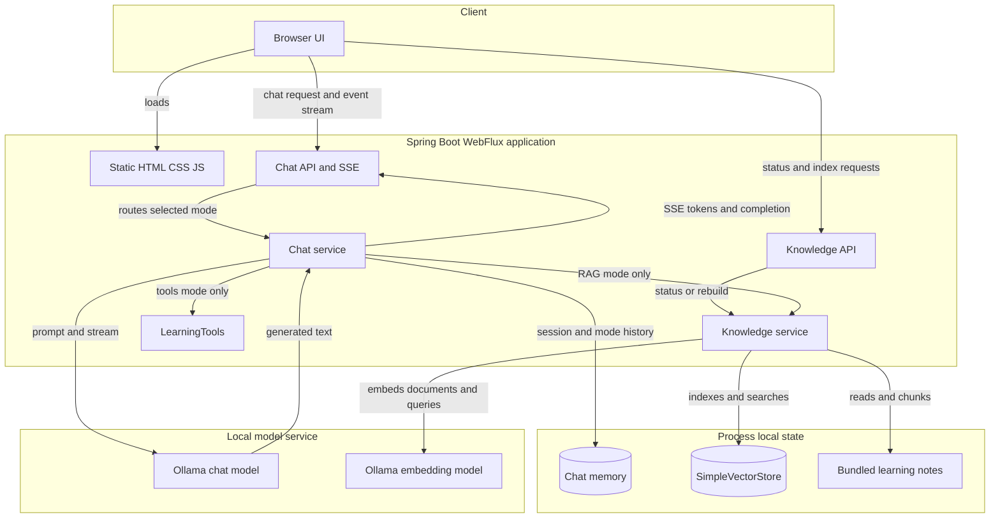
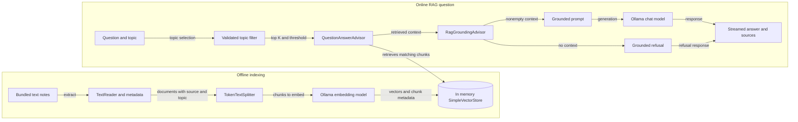

# Spring AI Fundamentals

An interactive learning app for modern AI concepts and the Spring AI programming model. Read the lessons, inspect Java examples, and experiment with a local tutor, document retrieval, and an optional Java-tools mode.

## What’s implemented

- **AI fundamentals:** the AI → machine learning → deep learning → generative AI relationship, how LLMs generate text, tokens, context windows, hallucinations, and training cutoffs.
- **Spring AI lessons:** `ChatModel` versus `ChatClient`, provider configuration, prompts and message roles, templates, model options, response metadata, streaming, multimodal input, structured output, and advisors.
- **RAG lessons:** embeddings, vector dimensions, similarity search, top K, similarity thresholds, metadata filters, and the extract → transform → load indexing pipeline. Advanced examples introduce query rewriting, routing, hybrid search, reranking, and context compression.
- **Spring AI RAG APIs:** `EmbeddingModel`, `Document`, `VectorStore`, `SearchRequest`, the ETL interfaces, `QuestionAnswerAdvisor`, custom context templates, and the modular `RetrievalAugmentationAdvisor`.
- **Tool-calling lessons:** tool descriptions and generated schemas, the model/application execution loop, argument validation, and application-controlled context through `ToolContext`.
- **RAG by default:** the chat starts in Learning tutor (RAG) mode, and API requests that omit `mode` also default to RAG. This mode retrieves relevant passages from bundled notes and does not invoke `LearningTools`. General tutor mode is an explicit alternative without retrieval; only the separately selected tools mode exposes the read-only Java functions in `LearningTools`.
- **Automatic first-use indexing:** the first RAG question prepares the bundled learning notes, splits them into chunks, creates embeddings with Ollama, and loads an in-memory `SimpleVectorStore`. Concurrent first questions share the same build. Later questions reuse the index, and the browser’s rebuild button or API can refresh it. Starting the app does not call Ollama.
- **Advisor-based RAG:** `QuestionAnswerAdvisor` searches the indexed notes and augments the user prompt. A downstream grounding advisor stops empty retrievals before the chat model is called. The application appends retrieved source filenames from the advisor context to the answer.
- **Metadata filtering:** RAG requests can select all notes or restrict retrieval to `rag`, `spring-ai`, or `tools` using the indexed `topic` metadata. Java validates the selection and builds the filter; clients do not submit raw filter expressions.
- **Session chat memory:** a `MessageChatMemoryAdvisor` supplies a bounded in-memory message history using a server-managed WebSession ID and a separate history for each mode. The “New chat” button clears all three mode histories for the current session.
- **Reactive streaming:** `ChatClient` streaming responses feed Server-Sent Events to the browser. The interface displays text incrementally and renders conversation content as text rather than HTML.
- **Input validation:** chat requests reject blank messages and messages longer than 2,000 characters; tool arguments are validated in Java.

Some lesson snippets are illustrative: multimodal prompts, structured-output conversion, non-text document readers, metadata enrichers, modular RAG pipelines, and action-taking tools are not wired into the interactive chat.

## Architecture

The application is a single Spring Boot WebFlux service with a browser-based learning UI. It has three deliberately separate chat paths: retrieval-augmented generation (the default), a general tutor without retrieval, and optional read-only Java tools. Ollama provides the chat and embedding models; bundled notes ship with the application, while the vector index and chat memory are held in process memory.

### Application architecture

<!-- mermaid-checked: no \n, no em-dash/en-dash, no {} in labels, subgraphs are id["label"], arrows are -->|"label"|, all subgraphs closed by end, ids unique -->


### Chat modes and request flow

`POST /api/chat` validates the message, mode, and optional RAG topic before dispatching to `ChatService`. The browser starts in RAG mode; the API also defaults to RAG when `mode` is omitted. Each mode uses a separate conversation-history key for the same WebSession.

| Mode | Retrieval | Java tools | Model behavior |
| --- | --- | --- | --- |
| `rag` (default) | Searches bundled notes with `QuestionAnswerAdvisor` | None; `LearningTools` is not registered | Grounds responses in retrieved passages; adds retrieved source filenames |
| `tutor` | None | None | Answers using the tutor system prompt and chat model |
| `tools` | None | Read-only `LearningTools` methods | The model may request the current time or a lesson outline; Java validates and executes the request |

Chat responses stream as Server-Sent Events. Token events carry generated text, RAG adds source names after the answer, and a done event closes the stream. Validation failures before streaming starts return a JSON error; failures during streaming are sent as a user-safe error event. `DELETE /api/chat` clears the current session’s histories in all three modes without removing the knowledge index.

### RAG indexing and retrieval

Indexing and answering are separate phases. Starting the app or checking `GET /api/knowledge` does not call Ollama. On the first RAG question, the service prepares the index; simultaneous first questions share the same build. A manual rebuild through the UI or `POST /api/knowledge/index` builds a replacement first and only publishes it after a successful index.

<!-- mermaid-checked: no \n, no em-dash/en-dash, no {} in labels, subgraphs are id["label"], arrows are -->|"label"|, all subgraphs closed by end, ids unique -->


The index pipeline reads `src/main/resources/knowledge/*.txt`, attaches source and topic metadata, splits documents into chunks, embeds them with the configured Ollama embedding model, and loads a `SimpleVectorStore`. The current defaults retrieve at most three chunks and apply a 0.45 similarity threshold. A selected topic restricts candidates to `rag`, `spring-ai`, or `tools`; Java builds the filter rather than accepting a raw filter expression from the client. If retrieval returns no usable notes, the grounding advisor prevents the chat model from being called. Successful RAG answers include the distinct source filenames from the retrieved documents.

The vector store and bounded chat memory are process-local, not a database or external vector service. An app restart clears both; the next RAG question rebuilds the index. Indexing and querying must use the same embedding model and vector dimensions.

### Components and responsibilities

| Component | Responsibility |
| --- | --- |
| Browser UI (`static/index.html`, `app.js`, `styles.css`) | Selects chat mode and RAG topic, submits requests, reads SSE, and reports index status |
| `ChatController` | Validates chat requests, obtains the WebSession, routes streaming events, and clears session histories |
| `ChatService` | Dispatches RAG, tutor, and tools modes; configures prompt and memory advisors; streams model output |
| `KnowledgeController` | Reports knowledge status and exposes an explicit index rebuild endpoint |
| `KnowledgeService` | Loads and chunks notes, builds or replaces the vector store, and supplies topic-filtered search settings |
| `QuestionAnswerAdvisor` | Searches the selected vector store and adds matching note text to the RAG prompt |
| `RagGroundingAdvisor` | Stops generation when retrieval provides no documents |
| `LearningTools` | Supplies explicitly registered, read-only time and lesson-outline functions in tools mode only |
| Ollama | Hosts the configured chat model and embedding model locally |

Spring AI's `MessageChatMemoryAdvisor` keeps bounded in-memory histories using the server WebSession ID plus the mode. The chat model and embedding model share the configured Ollama endpoint but serve different roles. No relational database, persistent vector database, web-search service, or external tools service is part of this app.

### Technology stack

| Layer | Technology | Version | Purpose |
| --- | --- | --- | --- |
| Browser | HTML, CSS, JavaScript | — | Learning UI and SSE client |
| Web application | Spring Boot, Spring WebFlux | 4.0.0, Spring Boot managed | Static resources and reactive HTTP APIs |
| AI integration | Spring AI | 2.0.1 | ChatClient, Ollama models, advisors, embeddings, vector store |
| Runtime | Java | 21+ | Application services and tool execution |
| Chat model | Ollama, `llama3:latest` by default | Configurable | Tutor and RAG answer generation; tools mode needs a tool-capable model |
| Embedding model | Ollama, `nomic-embed-text` by default | Configurable | Document indexing and query vectors |
| Knowledge storage | `SimpleVectorStore` | In-memory | Note text, metadata, and embeddings; rebuilt after restart |
| Conversation storage | Spring AI chat memory | In-memory | Bounded, per-WebSession and per-mode history |

### Architectural decisions and boundaries

- RAG, tutor, and tools are explicit alternative modes, not a combined autonomous workflow. In particular, the default RAG path does not register or invoke `LearningTools`.
- `SimpleVectorStore` keeps this learning app self-contained and demonstrates the vector-store API; it is not durable or shared across application instances.
- First-use indexing happens on a RAG request rather than app startup, and replacement indexes are published only after a successful build.
- Topic filters select among this shared set of learning notes. They are relevance controls, not user authorization or access controls.
- The RAG search uses the current user question; it does not rewrite it from conversation history. The model is instructed to answer from retrieved notes, but generated answers are not guaranteed correct.

## Requirements

- Java 21 or newer
- Maven 3.9+
- [Ollama](https://ollama.com/) installed and running locally

## Run locally

Start Ollama if it is not already running:

```bash
ollama serve
```

In another terminal, download the default chat and embedding models, then start the app:

```bash
ollama pull llama3:latest
ollama pull nomic-embed-text
mvn spring-boot:run
```

Open [http://localhost:8080](http://localhost:8080). The chat starts in **Learning tutor (RAG)** mode and uses both models. API chat requests also use RAG when `mode` is omitted. Its first question prepares the notes automatically, which can take longer while the embedding model loads. Ollama defaults to `http://localhost:11434`; use `OLLAMA_BASE_URL` to change its address and `OLLAMA_CHAT_MODEL` to select another installed chat model.

### Try RAG

Ask a question such as “Why must indexing and querying use the same embedding model?” RAG is already selected. If no index exists, the server builds it before retrieving passages for that question. If preparation fails, chat reports the setup problem instead of falling back to an answer without retrieval. After a successful build, later questions reuse the index.

Choose **General tutor (no retrieval)** only when you want the model to answer without the learning notes. That explicit mode requires only the chat model.

Use the RAG topic selector to search **All notes**, **RAG**, **Spring AI**, or **Tools**. For example, select **RAG** and ask “How does QuestionAnswerAdvisor augment a prompt?” The filter restricts the candidate documents before similarity ranking. It is a relevance control for this shared learning collection, not an authorization boundary.

Indexing and retrieval remain separate phases. The app runs the indexing phase on first use when needed, then searches the completed index:

```text
Indexing: bundled notes → documents + metadata → chunks → embeddings → vector store
Question: user question + topic → QuestionAnswerAdvisor → similar chunks → context + question → answer
```

An embedding is a numeric vector used to compare meaning. The vector store keeps the original text and metadata alongside each vector; generation uses the retrieved text, not a conversion of vectors back into words. Top K limits the number of returned chunks, and the similarity threshold removes weak matches.

The index is held in application memory. After an app restart, the next RAG question prepares it again automatically. Use **Rebuild learning notes** or `POST /api/knowledge/index` to refresh an existing index after changing bundled notes or embedding configuration. Indexing and querying must use the same embedding model and dimensions. Updating the index does not retrain the chat model.

### How the Spring AI RAG pieces fit

`EmbeddingModel` is the portable embedding-provider contract. It can embed one string or a batch, while `VectorStore` normally calls it for document indexing and question retrieval:

```java
float[] vector = embeddingModel.embed("How does retrieval work?");
List<float[]> vectors = embeddingModel.embed(List.of("First passage", "Second passage"));
```

A `Document` carries text and metadata. `vectorStore.add(documents)` embeds and stores both; `similaritySearch(SearchRequest)` embeds the query and returns matching original documents. A matching vector-store starter can supply a configured store bean. This demo builds a `SimpleVectorStore` explicitly so a successful reindex can atomically replace the previous store. Production stores have their own setup, schema, and filtering capabilities. See the [Spring AI vector store API](https://docs.spring.io/spring-ai/reference/api/vectordbs.html).

The indexing stages are composable Java contracts:

| Stage | Spring AI interface | Java functional interface | Active implementation |
| --- | --- | --- | --- |
| Extract | `DocumentReader` | `Supplier<List<Document>>` | `TextReader` over bundled notes |
| Transform | `DocumentTransformer` | `Function<List<Document>, List<Document>>` | `TokenTextSplitter` |
| Load | `DocumentWriter` | `Consumer<List<Document>>` | `SimpleVectorStore`, through `VectorStore` |

The same pipeline can be expressed as `vectorStore.add(splitter.split(reader.read()))`. The lessons also introduce `PagePdfDocumentReader`, `TikaDocumentReader`, `JsonReader`, and `MarkdownDocumentReader`; the PDF, Tika, and Markdown readers require their corresponding optional dependencies. `KeywordMetadataEnricher` and `SummaryMetadataEnricher` can add model-generated metadata, at the cost of additional model calls. They are educational examples here. See the [Spring AI ETL pipeline](https://docs.spring.io/spring-ai/reference/api/etl-pipeline.html).

The active RAG path adds the BOM-managed `spring-ai-vector-store-advisor` dependency and supplies a configured `QuestionAnswerAdvisor` to `ChatClient`. Its custom `PromptTemplate` includes both required placeholders: `{query}` for the question and `{question_answer_context}` for retrieved passages. Each request supplies a `SearchRequest` with top K, the similarity threshold, and any topic filter built with `FilterExpressionBuilder`. This avoids concatenating user text into a filter. The lessons also show the advisor's string-valued `QuestionAnswerAdvisor.FILTER_EXPRESSION` parameter as an alternative. See the [QuestionAnswerAdvisor reference](https://docs.spring.io/spring-ai/reference/api/retrieval-augmented-generation.html#_questionansweradvisor).

The advisor retrieves once for each request. The grounding advisor checks the retrieved documents before allowing generation; matched documents remain reference data, and the prompt asks the model to acknowledge insufficient evidence. The source list identifies retrieved files and does not prove that every statement in a generated answer is supported.

For more control, the lessons show `RetrievalAugmentationAdvisor` from the optional `spring-ai-rag` module. Its stages support query transformers (`CompressionQueryTransformer`, `RewriteQueryTransformer`, `TranslationQueryTransformer`), expansion (`MultiQueryExpander`), retrieval (`VectorStoreDocumentRetriever`), and generation context (`ContextualQueryAugmenter`). This modular pipeline is an example to study; the running app uses `QuestionAnswerAdvisor`. See [modular RAG](https://docs.spring.io/spring-ai/reference/api/retrieval-augmented-generation.html#_retrievalaugmentationadvisor).

### Try tool calling

Use a chat model that supports tool calling. For example, download `llama3.1:latest`, then start the app with it:

```bash
ollama pull llama3.1:latest
OLLAMA_CHAT_MODEL=llama3.1:latest mvn spring-boot:run
```

Choose **Tools** and ask “What is the current date and time?” or “Show the RAG lesson outline.” The available tools are read-only application methods; the model chooses whether to request them, and Spring AI executes the Java code and passes results back to the model. The tool mode requires model support; the default `llama3:latest` model is intended for the ordinary tutor and RAG modes.

The registered methods are:

| Tool | Model-supplied arguments | Application behavior |
| --- | --- | --- |
| `getCurrentDateTime` | None | Reads the clock in the server-configured time zone supplied through `ToolContext` |
| `getLessonOutline` | `topic`: `fundamentals`, `spring-ai`, `advisors`, `rag`, or `tools` | Validates the topic and returns its lesson outline |

`ToolContext` supplies trusted configuration from the application rather than letting the model choose it. The time zone defaults to `Asia/Kolkata`; set `APP_TIME_ZONE` to change it. A tool call remains untrusted input: Java code validates model-supplied arguments and controls which operations are available. These examples do not send messages, update external systems, or access customer data.

RAG and tools solve different problems and can be combined in larger applications:

| Pattern | Supplies | Example in this app |
| --- | --- | --- |
| RAG | Relevant passages from indexed documentation | Explain embeddings using the bundled notes |
| Tool calling | Results from application code at request time | Read the current time or a lesson outline |
| Chat memory | Earlier conversation turns | Answer a follow-up in the same browser session |

### Ollama configuration and troubleshooting

The HTTP response timeout defaults to 5 minutes for model loading and local inference. Override `OLLAMA_RESPONSE_TIMEOUT` with a Spring duration such as `2m` or `90s`. `OLLAMA_EMBEDDING_MODEL` selects the embedding model and defaults to `nomic-embed-text`. These environment variables configure the Spring AI 2.0 properties `spring.ai.ollama.chat.model` and `spring.ai.ollama.embedding.model`. Retrieval defaults to `app.rag.top-k: 3` and `app.rag.similarity-threshold: 0.45` in `src/main/resources/application.yml`; adjust these to balance coverage and weak matches.

If a request fails, confirm Ollama is reachable and the required model is installed:

```bash
curl http://localhost:11434/api/tags
ollama list
```

A Reactor Netty `ReadTimeoutException` means Ollama did not respond within the configured timeout. Connection-refused errors usually mean Ollama is not listening at the configured address. Check Ollama’s logs and machine resource usage, verify `OLLAMA_BASE_URL`, and allow time for model loading. A missing embedding model affects indexing/RAG; an unsupported tool model affects tools mode.

## API

### `POST /api/chat` (Server-Sent Events)

```json
{
  "message": "How does chunking improve retrieval?"
}
```

`mode` is optional and defaults to `rag`. The server prepares the index on first use and retrieves notes before generation; this RAG path does not use `LearningTools`. Set `mode: "tutor"` explicitly to answer without retrieval or Java tools, or `mode: "tools"` to expose the read-only methods in `LearningTools`.

RAG also accepts optional `topic`: `all` (the default), `rag`, `spring-ai`, or `tools`. A topic is valid when `mode` is omitted because that request uses RAG. Omit `topic` for explicit tutor and tools requests. Invalid topics or a topic supplied outside RAG mode return `400 Bad Request`; raw filter strings are not accepted.

Successful responses use `Content-Type: text/event-stream`. Text arrives in `token` events, followed by `done`. RAG uses these same events and appends its source list as text:

```text
event:token
data:Hello

event:token
data: there!

event:done
data:
```

Try the default RAG chat:

```bash
curl -N http://localhost:8080/api/chat \
  -H 'Content-Type: application/json' \
  -H 'Accept: text/event-stream' \
  -d '{"message":"How does chunking improve retrieval?"}'
```

Restrict RAG to one topic:

```bash
curl -N http://localhost:8080/api/chat \
  -H 'Content-Type: application/json' \
  -H 'Accept: text/event-stream' \
  -d '{"message":"How does chunking improve retrieval?","mode":"rag","topic":"rag"}'
```

Use the general tutor without retrieval explicitly:

```bash
curl -N http://localhost:8080/api/chat \
  -H 'Content-Type: application/json' \
  -H 'Accept: text/event-stream' \
  -d '{"message":"Explain what a token is","mode":"tutor"}'
```

Try a tool-capable model:

```bash
curl -N http://localhost:8080/api/chat \
  -H 'Content-Type: application/json' \
  -H 'Accept: text/event-stream' \
  -d '{"message":"What is the current date and time?","mode":"tools"}'
```

Invalid input returns `400 Bad Request` with a JSON error before streaming starts. Failures after streaming begins produce a user-safe `error` event followed by `done`; provider exception details are logged on the server. An empty filtered retrieval produces a normal streamed refusal without calling the chat model. If first-use indexing cannot complete, a streamed error explains that Ollama and the configured embedding model must be available; the next request can retry preparation.

Browser cookies maintain the WebSession used for chat memory. With curl, use a cookie jar (`-c cookies.txt -b cookies.txt`) across requests to continue the same conversation.

### `DELETE /api/chat`

Clears the current WebSession’s chat history in all three modes. The browser’s “New chat” button calls this endpoint. It does not remove the document index.

### `GET /api/knowledge`

Returns the current in-memory indexing status. Reading status does not load documents or call Ollama. The response includes `indexed`, `documentCount`, `chunkCount`, `embeddingModel`, and `indexedAt` (an ISO instant, or `null` before indexing).

```bash
curl http://localhost:8080/api/knowledge
```

### `POST /api/knowledge/index`

Explicitly rebuilds the bundled learning notes using the configured embedding model and returns the same status fields as `GET /api/knowledge`. A successful rebuild atomically replaces the existing in-memory store. This is optional before the first question because RAG prepares a missing index automatically. Use it to refresh an existing index when notes or embedding configuration change:

```bash
curl -X POST http://localhost:8080/api/knowledge/index
```

## Run tests

```bash
mvn test
```

## Important limitations

- Model-generated answers can be incorrect or out of date. Retrieved context reduces a knowledge gap but does not guarantee accuracy.
- The vector index and chat memory are process-local and lost on restart. They are learning examples rather than durable, shared storage.
- RAG searches only bundled learning notes. There is no arbitrary file upload, PDF ingestion, external vector database, or live web search.
- Topic metadata filtering is implemented. Arbitrary filters, query rewriting, expansion, reranking, hybrid search, and the modular RAG advisor remain educational examples.
- Retrieval searches the current message without rewriting it from chat history. Restate the topic in follow-up questions when needed.
- Tools are limited to the explicitly registered read-only methods. The model cannot independently execute arbitrary Java, access private systems, or take external actions.
- Models vary in tool-calling support and reliability. Use a compatible model for tools mode.
- Multimodal input, provider switching, structured-output conversion, and recursive validation remain illustrative examples.
- Chat prompts are limited to 2,000 characters. This local demo does not implement production authentication, authorization, indexing access controls, or rate limiting.

## Further reading

- [Spring AI RAG reference](https://docs.spring.io/spring-ai/reference/api/retrieval-augmented-generation.html)
- [Spring AI tool calling reference](https://docs.spring.io/spring-ai/reference/api/tools.html)
- [Spring AI vector store reference](https://docs.spring.io/spring-ai/reference/api/vectordbs.html)
- [Spring AI ETL pipeline reference](https://docs.spring.io/spring-ai/reference/api/etl-pipeline.html)
